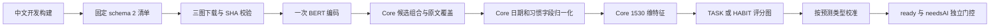

# Kivo 客户端开发接入 v1

2026-10-19。用户在确认新旧协议不兼容后，选择真正接入 Kivo，先用于开发测试。冻结版本：[v0.1.0-preview.1](https://github.com/DeadlinerStudio/Kivo/releases/tag/v0.1.0-preview.1)。

## 实现与入口

Core 提交 `3a6940b5ca035b5b021e1ed3950ae0aa95a885ac` 新增八角色解码、覆盖校验、1515/1530维特征、三图会话与校准门控。`QuickAddModelSession` 按 schemaVersion=2 路由至 Kivo；schema 1 仍采用旧 BIO。平台桥接和业务 Proposal 签名保持兼容。

一次输入只运行一次编码器及预测类型对应的一个评分头；三图全部校验、加载完成才就绪。任一准备失败或取消都会关闭部分会话；输入不等待下载。关闭、失败重试、语义拒绝和陈旧输入保护继续独立处理。

| 客户端 | 开发入口 | 图格式 | 生产与英文 |
| --- | --- | --- | --- |
| Android | `BuildConfig.DEBUG`，`src/debug/assets/quick-add-model-kivo-preview.json` | 3 × ONNX | 原有清单 |
| iOS | `#if DEBUG`，`Resources/quick-add-model-kivo-preview.json` | 3 × Core ML | 原有清单 |
| HarmonyOS | `context.applicationInfo.debug`，rawfile 同名清单 | 3 × MindSpore | 原有清单 |

三端同一份[开发清单](../integration/joint-v1/kivo-client-preview.json)已写入各自工作树；模型下载地址均指向 Kivo Release 的版本化附件。清单包含匹配 tokenizer、每平台 encoder/TASK/HABIT 文件的 SHA/大小、冻结 Platt 参数与阈值；下载后按 SHA 命名缓存，不接受部分模型或错误内容。

正式部署应依据发布门禁另行切换，不能把开发开关改为全量启用。中文开发构建首次打开快速添加会准备三份本平台图；无须下载其他平台的权重。

## 可添加草案与 AI 入口

source 沿用实际 Core 的 `MODEL`，不再按早期草案映射为 `LOCAL`。高置信度完整结果为 `ACCEPTED`；完整低置信度为 `READY_WITH_AI`；Kivo 硬失败为 `KIVO_PARTIAL`。`ready` 只表示草案通过硬校验，`needsAI` 控制 AI 入口。

Android/iOS 允许 `READY_WITH_AI` 草案添加，同时保留 AI。手动改日期不清除 Kivo 已返回的标题/地点不确定性，也不能将 `KIVO_PARTIAL` 变成完整草案。原有手动创建路径保持。开发构建中的规则草案尚无模型置信度，额外保留 AI 入口；有效的规则草案仍可手动添加。Harmony 已按 ready 控制添加，本轮补齐高置信度隐藏 AI、低置信度及规则回退保留 AI。

空输入不展示 AI；超长输入、字面特殊 tokenizer 控制 token、未消费内容、非法日期/日程等转确认，不截断后接受。没有新增自动保存。

## 实测证据

- 73 项 Core 快速添加检查通过，包含三图中途失败清理、重试、取消传播、输入不等待下载、硬失败保护和低置信度可添加。
- 使用实际 ONNX 输出，Core 对齐 14 条完整提案、1530维特征及 18 条 tokenizer/code point 偏移参考；这些都是已曝光开发样例，不是新准确率证据。
- 新移动导出包含固定 batch=1 的评分图。ONNX/Core ML/官方 ARM64 Linux MindSpore 均实际执行 64 条编码器输入与每头14条真实特征；最大原始输出绝对差 Core ML 约 0.0001502、MindSpore 约 0.0004687。
- 再将实际 Core ML/MindSpore 编码器输出交给真实 Core，使用其特征执行对应原生评分头：两种后端各14条完整提案与AI门控一致，最大置信度差分别约 `6.59e-8` / `3.38e-7`。
- 实际 Swift 草案覆盖逻辑的宿主检查通过；Android 新增低置信度/日期覆盖和开发回退AI可见性三项行为回归，随客户端构建验证。
- 所有公开冻结附件均已实际下载核对；移动附件另见 `SHA256SUMS-mobile`，原始附件及原始 `SHA256SUMS` 保持不变。

三格式是桌面/官方 Linux 运行库实测，不是三端手机实测。Kivo 的主合成留出高覆盖不代表真实泛化达标；已曝光旧表达回放仍为63.54%，`formalGatePassed=false`。

## 本地构建验收

当前进行中：Core Debug AAR / XCFramework / Harmony共享库构建，随后进行 Android、iOS、Harmony 开发构建。最终结果与产物哈希回写本节和 `docs/evidence/`。未执行任何用户设备安装、截图或数据操作。

## 补丁与依赖

[Core运行时补丁](../integration/core/0002-kivo-multi-graph-runtime.patch)依赖[结构化习惯字段补丁](../integration/core/0001-kivo-structured-habit-fields.patch)及 Core 本地既有基础。Core 的6个既有未推送祖先包含 Quick Add 基础模块；本轮没有连带推送这些提交，因此不能把补丁直接用于缺少基础模块的旧远端。

客户端代码的范围补丁见 `integration/clients/`；它以本轮开始时的工作树为基础，保留既有用户修改，不保证可直接应用到较旧远端。新 JSON 清单独立保存，上表列出的三个路径复制同一清单即可。
