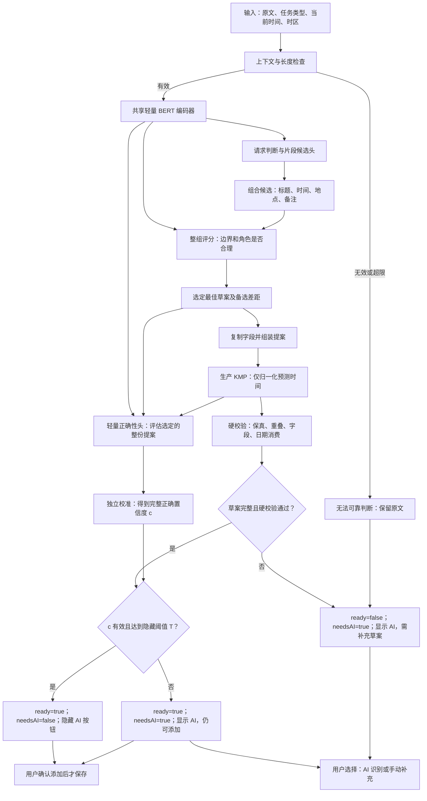

# Quick Add 提案置信度架构 v1

状态：**用户已确认启动；保留冻结设计基线**。日期：2026-10-19。

当前实证与实现差异见[联合原型报告v3](task-habit-joint-prototype-v3.md)。下文的“拟/待实现/仅设计”保留设计阶段语境，不表示完整实验矩阵或产品门禁已经通过。

本次修订：用户确认将“可添加”与“是否显示AI入口”分开；完整且硬校验通过的低置信度草案使用`ready=true、needsAI=true`。

最新扩展见[TASK/HABIT联合设计v2](task-habit-joint-design-v2.md)：共享BERT提取习惯结构字段，分类型校准；本文保留TASK基础架构，联合范围以v2为准。

配套：[实验方案](proposal-confidence-experiment-v1.md)。权威需求仍在共享 [Features 规格](../../Features/PRD/quick-add-pretrained/spec.md)，本文是本轮设计附件。本文没有对应的新权重、客户端实现或部署产物。

## 1. 目标与设计决定

- 中文核心单任务：识别标题、明确时间、可选地点/备注；地点继续写入既有note。
- 目标是≥70%的应接受输入获得完整正确、可以直接添加的本地提案，同时把错误接受压到尽可能低。
- 按用户选择，**本地判断可靠时隐藏AI按钮；不可靠时显示**。90%是第一档实验阈值，不是已经达标的上线门槛。
- 置信度衡量“这一份具体提案是否完整正确”，而不是“这句话是不是任务”。
- `ready`表示草案具备添加条件；`needsAI`表示是否显示AI入口，两者可以同时为true。低置信度不单独禁止用户添加。
- 主线采用片段候选与整组评分；现有标准化路线作为对照。以下结构是拟实现方案，不将两条旧模型的一致当作正确证明。

## 2. 在线架构图（Mermaid）



图中失败状态针对非空输入；空输入不显示AI按钮，也不能提交。模型与规则只生成草案，不自动写数据库，不自动调用云端AI。

## 3. 模型与规则的职责

| 模块 | 输入与输出 | 拟实现方式 |
| --- | --- | --- |
| 共享编码器 | WordPiece→上下文向量 | 首轮沿用当前2层、128维BERT，最多96 tokens，不截断 |
| 请求/片段头 | supported/confirm；角色与原文位置候选 | 复用当前角色TITLE/TIME/LOCATION/NOTE/CONNECTOR，不把请求概率当提案置信度 |
| 组合搜索 | 候选片段→最多32份不重叠组合 | 每角色最多取4个候选，允许LOCATION/NOTE为空；TITLE必须有；TIME最多两个有序片段。beam上限固定，超出或无有效组合转确认 |
| 整组评分 | 一组字段+上下文→排序分数 | 用句向量、各片段池化、相对位置、边界邻域和候选分数轻量评分；评价地点尾部是否被划入标题等问题 |
| 日期/组装 | 原文复制字段→既有业务提案 | 日期算术只用现有KMP；不从标题重新抽日期，不编造缺失截止时间 |
| 正确性头 | 最佳组合、上下文、备选差距、实际日期结果→原始logit z | 单独训练二分类头；只给选定草案评分，不用该头再次重排候选，避免循环选择 |
| 校准器 | z→c | 拟用单调Platt校准 `sigmoid(a*z+b), a>0`；校准不是改正字段错误 |
| 硬校验/决策 | 提案、来源位置、c、冻结配置→ready/needsAI | 拒绝未解释原文、重叠/非法角色、无事件、未消费时间、解析失败等；高分不能覆盖失败 |

只有一次BERT编码；排序头和正确性头复用其输出，不再串联第二个完整BERT。候选数/beam上限是首轮设计预算，待dev诊断后冻结；不在最终测试上改搜索规模。实际参数量和耗时须测量，不能据架构图宣称真机速度。

排序头负责“这些候选中哪份更好”；正确性头负责“选中的这份是否足够可靠，可以隐藏AI入口”。两者共享特征，**不构成独立证据**。最终仍依赖单独校准、风险验证和未曝光测试。

硬校验与模型软分数必须分开：原文溯源、禁止重叠、缺少事件/明确时间、非法字段与日期未完整消费属于硬失败；旧请求概率门槛、片段分数和备选差距属于软证据，在新置信度实验中不能又作为旧阈值重复拦截。CONNECTOR标签只提出可删除成分，仍需通过角色/位置限定的合法删除规则，不能把任意被模型标为连接词的内容直接丢弃。

### 一个必须学会的比较

```text
输入：明天下午4点在翠竹社区接待处办理设备报废登记

正确组合：标题=办理设备报废登记；地点=翠竹社区接待处
错误组合：标题=接待处办理设备报废登记；地点=翠竹社区
```

两种组合都可能保留所有字。保真检查无法区分，需要整组评分及正确性训练；不以新增具体地名字典作为解决方案。

## 4. 置信度定义

`c`拟估计：在给定原文、当前时间/时区及这份模型提案时，输入属于支持范围且**整份业务提案正确**的概率。

训练标签只有在以下条件全部成立时为1：金标决策允许接受，kind/title/dueAt/note及其余既有业务字段全部匹配。其他情况均为0，包括“文字齐全但放错字段”。部分字段正确不能算正例。

不能使用以下替代定义：请求softmax、各token概率的平均值、最小token概率、两个模型投票一致。它们可作为诊断/辅助特征，但不能直接命名为完整提案正确概率。

校准使用与训练隔离的数据，专门对**实际被选中的最佳草案**做拟合，不能把任意候选混在一起校准后用于最佳草案。无可用评分、非有限数或校准版本不匹配时c为空，显示AI入口；若草案本身完整、硬校验与解码版本有效，仍可ready=true。没有草案、模型/解码协议无效或硬校验失败时ready=false。硬校验失败时保留原始c供诊断，但不允许隐藏按钮。

## 5. needsAI 与 ready

令`T`为配置中冻结的隐藏阈值；首轮比较0.90/0.95/0.98/0.99/0.995/0.999。

```text
draftValid = 输入有效 && 存在完整草案 && 硬校验通过 && 模型/解码版本有效
localTrusted = draftValid && c有效 && c >= T && 校准/门控策略版本一致

ready   = draftValid
needsAI = 非空输入 && !localTrusted
```

| 状态 | ready | needsAI | AI按钮 | 草案处理 |
| --- | --- | --- | --- | --- |
| 空输入 | false | false | 隐藏 | 无提案 |
| 非空、识别中 | false | true | 显示，按忙碌状态禁用 | 不采用旧输入结果 |
| 草案完整且校验通过，c低于T | true | true | 显示 | 保留草案，用户可直接添加或调用AI |
| 草案完整且校验通过，评分缺失/校准不可用 | true | true | 显示 | 不声称高置信度，仍可由用户添加 |
| 硬校验失败，即使c很高 | false | true | 显示 | 附原因，不猜测修复 |
| 校验通过且c≥T | true | false | 隐藏 | 允许用户直接添加 |

阈值相等时进入高置信度候选，但仍必须满足其他条件。低于90%一律不能隐藏；高于90%是否隐藏由最终冻结的T及校验决定。若没有阈值同时满足高置信度覆盖与风险目标，本轮报告失败，不用增加ready=true草案数或规则回退来掩盖。

`ready`仅表示允许用户确认提交，绝不表示语义已被证明正确或自动保存；`needsAI=true`是显示AI入口，不强制用户先调用AI。用户主动调用云AI或手动修订后的确认路径独立处理，不用旧的本地c否决其新结果。

本地草案提交条件拟为`非空输入 && ready && 当前结果有效 && !busy`，不再附加`!needsAI`。当前Android的canSubmit、iOS的canSave仍要求`!needsAI`；后续接入必须同步调整，否则只修改两个标志仍不能添加低置信度草案。本轮只更新设计，不修改客户端。

单独选择一个日期不等于用户已确认标题和地点；后续接入须避免仅因填写日期就清除整份提案的低置信度状态。明确手动确认后的提案与尚未确认的模型草案应沿现有编辑流程区分。

## 6. 工程边界与接入顺序

1. **训练工程**先实现参考路径、数据隔离、离线KMP提案评估及校准配置；尚未开始。
2. **Core**后续承接候选选择、原文保真、日期归一化和最终门控；三端不能各自复制阈值策略。现有原型Python逻辑只是实验参考实现。
3. **客户端**消费既有ready/needsAI：ready控制能否添加，needsAI控制AI入口显示，忙碌/输入版本条件另外校验；后续逐端接入验收，本轮不改UI。

复用现有QuickAddProposal及训练草案结构，不新增任务/地点数据库实体。原型置信度与原因保留在实验诊断中；若客户端只需两个布尔值，不先扩张业务DTO。后续确需对外暴露confidence时才设计兼容的可选字段。

配置须绑定模型SHA、tokenizer/角色协议、排序头/正确性头、校准参数、阈值、原文校验策略及日期规则版本。新头是实验输出协议，不能直接套用现有v3清单；部署前另做三格式一致性和版本拒绝测试。

每次输入、类型、now/timezone更新都带请求版本；只允许当前版本结果更新状态。手动编辑后不得由旧异步模型结果覆盖；模型未下载、超长、异常或版本不符时保留AI入口。后续接入复用现有revision/取消机制，不为设计另造通用状态框架。

## 7. 设计审核重点

- 既定70%目标继续定义为“完整正确且高置信度接受（ready=true、needsAI=false）/ 应接受输入”；另报ready=true可添加草案的覆盖与错误，不能混作门控达标。
- 90%是实验起点；最终门槛是否允许提高到更高水平，以错误接受目标决定。
- 主线是否采用“共享BERT＋整组评分＋专用正确性头”；标准化保留为对照。
- 先完成离线验证，再进入Core/三端接入；本次设计审核不等同于发布授权。
