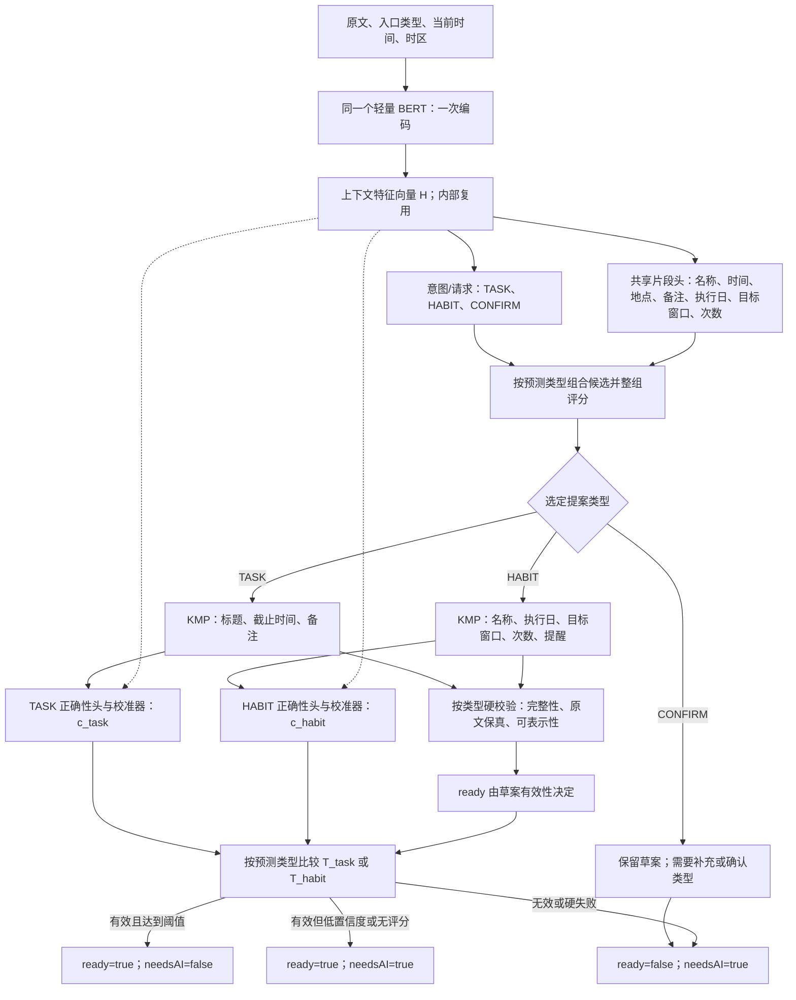

# TASK/HABIT 联合混合训练设计 v2

状态：**已确认离线实施；本文保留联合设计基线**。日期：2026-10-19。

当前实证与实现差异见[联合原型报告v3](task-habit-joint-prototype-v3.md)。下文的“拟/待实现/仅设计”保留设计阶段语境，不表示完整实验矩阵或产品门禁已经通过。

本文扩展[架构v1](proposal-confidence-architecture-v1.md)与[实验v1](proposal-confidence-experiment-v1.md)。涉及HABIT范围、角色、分类型校准、混合训练和数据预算时以本文为准；v1的数据隔离、完整提案评分、失败回写和ready/needsAI独立语义继续有效。

## 1. 本轮确认与建议

用户确认：HABIT需要从输入提取“哪几天、什么时候提醒、天级还是周级、几次、名字”，所说文本向量是完成这些结构提取的内部特征。**共用一个BERT，不新增相似度向量模型、向量库或检索任务。**

建议采用：共享BERT与角色提取，按TASK/HABIT组装和判断正确性，分别校准及确定隐藏AI的阈值。混合训练是否有收益必须通过对照验证，不能认为加入HABIT就自然提升TASK。

当前事实：旧版训练已有TASK/HABIT/OTHER意图和TITLE/TIME/REPEAT/NOTE；上一轮新片段原型只支持TASK。此次不是重新发明Habit领域模型，而是把已有业务契约接入新的候选、评分与校准设计。

## 2. 联合架构（Mermaid）



内部特征可按token表示为`H∈R[L,128]`，用于片段边界与角色；句级池化用于意图和提案评分。它们不是额外的持久化业务向量，也不自动具有相似度检索语义。首轮仍用当前2层128维编码器与96-token上限。

同一输入不再串行跑两个BERT。只执行实际选中类型的正确性分支；训练时两个分支都学，推理不使用真实类别分流。

一次编码不等于一定只有一次模型图调用：候选选择之后的轻量评分可以使用缓存H；后续导出须核对特征传输与head调用成本，但不能重复执行BERT，也不要求把H持久化或提供给新的外部业务接口。

## 3. 对齐现有习惯设计

业务依据：[Habit设计](../../Features/PRD/habit-redesign/spec.md)、[HabitSchedule](../../DeadlinerCore/shared/src/commonMain/kotlin/com/deadliner/domain/habit/HabitSchedule.kt)、[HabitGoal/Tracking](../../DeadlinerCore/shared/src/commonMain/kotlin/com/deadliner/domain/habit/HabitGoal.kt)。

| 用户要提取的内容 | 领域含义 | 现有QuickAdd载体 | 注意 |
| --- | --- | --- | --- |
| 名字 | Habit.name | title | 复制原文名称，不把周期或次数混入名称 |
| 哪几天 | schedule.weekdaysMask | weekdaysMask | 周一bit0到周日bit6；工作日31、周末96、每天127 |
| 天级/周级 | goal.window | period=DAILY/WEEKLY | DAILY对应每计划日目标，不代表“每天都执行” |
| 几次 | goal.targetCount | targetCount | 正整数；未指定时按既有产品默认1，不从提醒时间的数字取值 |
| 什么时候提醒 | reminder.localTime | reminderTime | 无提醒时间则为空，不编造；HABIT不生成TASK的dueAt |

**执行日和目标窗口是独立维度**：每周一三五执行，不等于一周累计三次；每周任意三次不等于周一三五。月级/累计目标是现有领域能力，但首轮H0建议先验收明确的日级/周级，不把其他窗口降级为DAILY。

### 必测金标例子

| 输入 | 名称 | 执行日 | 目标窗口/次数 | 提醒 |
| --- | --- | --- | --- | --- |
| 每天早上7点跑步 | 跑步 | 每天127 | SCHEDULED_DAY / 1 | 07:00 |
| 每周一三五跑步 | 跑步 | 一三五21 | SCHEDULED_DAY / 1 | 无 |
| 每周跑步三次 | 跑步 | 每天127 | WEEK / 3 | 无 |
| 工作日早上8点背单词，每天两次 | 背单词 | 工作日31 | SCHEDULED_DAY / 2 | 08:00 |
| 工作日每周跑步三次 | 跑步 | 工作日31 | WEEK / 3 | 无 |
| 本周三晚上7点跑步 | 跑步 | TASK，无重复日 | TASK截止时间按now计算 | 非HABIT提醒 |
| 每周三晚上7点跑步 | 跑步 | 周三4 | SCHEDULED_DAY / 1 | 19:00 |

这张表是拟定验收金标，不代表现有端侧管线均已支持。尤其“工作日+每周目标”要单独归一化两个维度，不能把原句直接丢给旧解析器就假定通过。

H0范围：中文、单个习惯、固定周几/工作日/周末/每天、每计划日或每周计次、最多一个固定提醒时刻、可选简单备注/地点。默认起点为当前本地日期，沿现有快速添加契约；显式未来起点/终点、间隔/算法计划、一次性Habit、多提醒、月级/累计目标及带“杯/分钟/公里”等计量单位先保留原文转展开/AI，ready=false，不以丢弃字段的方式伪装支持。

“每天读书30分钟”不能直接变成每天30次。现有QuickAddProposal不能完整表达tracking.unit、schedule.startOn/endOn等；本轮不新增业务实体，也不把这些信息塞进备注冒充结构化支持。

若明确从HABIT入口输入纯名称，可按现有默认“每天、每计划日1次、不提醒”构造草案，并显式记录默认来源；在通用/TASK入口仅有“跑步”时不凭名称猜成HABIT。入口是业务上下文，不能成为脱离文本的类别捷径。显式HABIT入口与预测TASK冲突时先确认，不自动保存成另一类型。

## 4. 模型输出与候选设计

共享角色拟为：`TITLE / TIME / LOCATION / NOTE / CONNECTOR / DAYS / GOAL_WINDOW / COUNT`。后三个为本轮内部监督增量，不进入数据库。

- TASK使用TITLE/TIME/LOCATION/NOTE，TIME解释为截止时间。
- HABIT使用TITLE/TIME/LOCATION/NOTE与DAYS/GOAL_WINDOW/COUNT，TIME解释为提醒时刻。
- DAYS标记执行日，如“工作日”“每周一三五”“每天”。GOAL_WINDOW标记另行声明的累计窗口，如“每周”；COUNT标记原文计次片段，如“三次”。“每周跑步三次”中“每周”归GOAL_WINDOW，不归DAYS；执行日使用明确的产品默认。
- 不让同一字符同时分配多个重叠角色。仅有“每天”时可由DAYS推出每计划日默认窗口，不为同一个词造第二个重叠标签；工作日与每天同时出现时可分别表达执行日与目标窗口。
- 类型、星期、窗口和次数不是靠模型自由生成。模型给原文位置；KMP确定性地计算mask、窗口、中文数字和提醒时刻，并记录哪些字段来自原文、哪些来自默认。

两个类型沿用最多4个/角色、beam最多32份的dev预算；HABIT新增角色会扩大组合空间，须单报正确组合召回及裁剪损失。不能以金标kind过滤候选后声称类型判定准确，也不能把HABIT新增角色文本当作可随意删除的连接词。

已有DATE解析不等于已有HABIT全部字段归一化。后续Core应复用QuickAddTemporalNormalizer和Habit领域类型，对DAYS/GOAL_WINDOW/COUNT补明确组装能力；不能复制三套客户端算法。TASK不重扫标题找日期，HABIT不重扫名字找频率或次数。

## 5. 训练：先联合表示，再冻结下游

**阶段A：共享编码器与提取头联合混合训练。** 起始采样建议TASK正例40%、HABIT正例40%、确认/不支持20%；确认样本同时覆盖两个类型。意图损失与按角色归一化的片段损失联合优化；TASK不适用的HABIT角色不能被错误标为正例。混合比例是dev对照参数，首轮仅比较40:40:20与60:20:20，不在最终集上选比例。

需要跨类型最小对比：明天跑步/每天跑步、本周三/每周三、每周三次/每周三、明天交每周报告/每周交报告，以及“每天复习三次函数”中的“三次函数”不能当目标3次。名称在TASK/HABIT之间交叉使用，preferredKind在各类中覆盖，避免记住“跑步=习惯、报告=任务”或入口即标签。

确认类样本也保留已知领域注释用于诊断；未知/歧义保持未知，不能为了凑TASK/HABIT比例强贴标签。复杂习惯和否定请求训练为确认，不把所有“没/不”标题都变负例。

**阶段B：冻结编码器与片段头，分别训练TASK/HABIT组合排序。** 使用与阶段A隔离的D_rank；实际组装/KMP结果全对才标正确候选。可共享排序网络的基础特征，但语义约束和类型特定特征分开，是否共享排序权重列入消融，首轮推荐小型分支。

**阶段C：冻结提取与排序，分别训练整份提案正确性头。** TASK正确性要求其全部字段正确；HABIT必须name、执行日、目标窗口、次数、提醒、备注和类型全对。实际被预测为HABIT的TASK错路由样本也必须给HABIT正确性头负标签；不能用真实类别把错误路由从训练/评估中筛掉。

联合损失先只用于共享表示与片段/意图训练，不把正确性头、校准器同时拉着编码器继续更新。若联合微调编码器，必须重跑两个类型的排序/正确性样本生成和全部校准。

## 6. 分类型校准与ready/needsAI

维护`c_task / T_task`与`c_habit / T_habit`，两类各自选0.90/0.95/0.98/0.99/0.995/0.999。不因TASK校准达标就隐藏HABIT的AI按钮，也不把向量相似度或意图概率当整份习惯正确概率。

```text
draftValid = 对应类型草案完整 && 硬校验通过 && 输出协议有效
localTrusted = draftValid && 该预测类型的c有效 && c >= 该类型T
               && 校准/门控版本匹配
ready = draftValid
needsAI = 非空输入 && !localTrusted
```

完整但低置信度仍ready=true/needsAI=true，可由用户添加；缺星期/窗口的显式信息、无法消费计次/提醒、无法表示高级计划等为硬失败，ready=false/needsAI=true。合法默认不等于缺字段，但必须能解释其来源。无提醒时间不构成失败。

HABIT完整性校验至少检查：非空名称、非空合法星期mask、支持的窗口和正整数目标、最多一个合法提醒、无TASK截止时间混入、原文无未解释片段、无被丢弃的高级计划/单位。高c不能越过这些检查。

## 7. 联合实验矩阵与公平性

| 编号 | 模型 | 用途 |
| --- | --- | --- |
| J0-T / J0-H | 同初始化的TASK专用与HABIT专用编码器 | 估计各域专用基线及共享是否产生负迁移 |
| J1 | 一个联合编码器、共享提取；一个正确性头、一个混合校准器 | 检查简单混合方案的风险，不默认采用 |
| J2（推荐） | 一个联合编码器、共享提取；分类型排序/正确性头/校准/阈值 | 同时复用表示并保留业务差异 |
| J2-ratio | J2的40:40:20与60:20:20 | 衡量HABIT/TASK比例取舍 |
| J3（按dev触发） | J2增加小型任务分支/adapter | 仅在负迁移持续存在时比较，仍只保留一个基础编码器 |

v1的贪心/组合评分及正确性头消融保留，但不把全部矩阵无条件做笛卡尔积。先用seed42筛查；主线和专用对照再用42/43/44复核。只在dev选一个联合冠军，之后冻结再做校准与最终测试。

主比较保持每域相同的训练输入、初始化、每域曝光次数、batch和优化器配方；联合编码器的总更新更多，必须披露。与两套专用模型之和比较总训练成本/权重/内存；另做相同总步数的联合对照，不能把额外训练预算直接归因于共享。不同头多出的参数另报。

比例实验固定总训练步数并报告各域真实曝光次数，它本身会改变域预算，不能宣称是严格同曝光的架构消融。联合冠军在dev先要求两类经验错误率均≤0.5%，再最大化两类完整正确覆盖的较小值，随后比较均值、最后比较成本；不能只选平均分最高的模型。没有候选满足目标则报告失败，或在最终测试前按预定负迁移/容量条件追加对照。

专用模型的域内成绩仅表示对应业务已指定时的能力；混流测试不得用真实类别给两套模型分流。若比较两模型在线路由方案，需真实路由器并计其错误和双模型成本，不能用oracle类别作弊。

## 8. 数据预算与统计修订

v1的8个隔离阶段继续保留，但每阶段都要覆盖两类。建议保留TASK预算，再新增等额HABIT预算；均尚未执行：

| 分区 | TASK域预算 | HABIT域预算 |
| --- | ---: | ---: |
| D_extract | 10,000 | 10,000 |
| D_rank | 2,000 | 2,000 |
| D_quality | 3,000 | 3,000 |
| D_dev | 1,000 | 1,000 |
| D_cal_fit | 1,000 | 1,000 |
| D_cal_gate | 2,000 | 2,000 |
| D_test_business | 2,000 | 2,000 |
| D_test_protection | 1,000 | 1,000 |
| 合计 | 22,000 | 22,000 |

合计最多44,000条域标注行；跨域同一句及其入口变体必须共用源组、同split，去重后的独立原文数另报，不能双计独立证据。每域业务集预定1,600正例+400确认，保护集各1,000；校准/最终人工核验预算对应最多12,000条域样本行。预算翻倍是质量验证的建议，不是已授权开始的标注任务；可先做较小合成筛查，但不以此宣称两个类型正式达标。

每个原文+请求上下文只有一份按联合范围定义的gold；不能在TASK分区把明确HABIT标成defer、在HABIT分区又标成accept来训练相互矛盾的模型。v1中因未支持而确认的HABIT表达，需要在新数据冻结时按H0范围重新定义并保留版本；不能修改历史报告的gold或结果。所有类型的最小对比/改写都按同源组隔离。

校准时按**实际预测类型**给评分分桶，不能按真实类型把错路由剔除：`y=1`必须金标允许接受、类型一致且全部字段正确。最终覆盖按金标TASK/HABIT正例分母统计；风险按实际被高置信度输出为TASK/HABIT的提案分母统计，错类型接受一律计错误。

两类合计搜索12个阈值检验，D_cal_gate每档用`alpha=0.05/12`精确二项上界，保持整体95%的保守风险检验。每预测类型须上界≤0.5%且相应金标域覆盖≥70%；例如1,000个接受结果零错误仍约0.547%，尚不足，1,120个零错误约0.488%。零错误至少需1,094个独立接受样本才可能过该门槛。不得在小样本HABIT上省掉统计检查。

最后一个联合冠军的两个阈值均已冻结；最终两类分别用`alpha=0.05/2`报告风险上界，并分别验收，联合整体置信水平按保守95%处理。该上界依赖预定样本独立性和混合分布，不保证真实用户分布零错误。

## 9. 验收与负迁移

- TASK与HABIT分别达到≥70%高置信度完整正确覆盖；不能只看合并后平均值。
- 两个预测类型各自满足拟定≤0.5%风险上界，保护集零高置信度误接受；额外报告类别混淆、ready=true低置信度错误草案。
- HABIT分别报告名称、执行日mask、目标窗口、次数、提醒时间精确率；只全对才算完整正确。reminder为空、目标默认1也参与严格比对。
- 新增保护：每周三/每周三次、星期数字/次数/钟点混淆、日级/周级窗口错位、月级/单位/未来起点被静默降级、只有周期时间却没有名称、TASK/HABIT错类型且隐藏AI。
- dev同一组输入上联合TASK覆盖比TASK专用下降>2个百分点，或HABIT同样下降>2点，视为需处理的负迁移；0.5%风险约束不变。先检查采样/任务损失与角色标注，再尝试J3；不得通过牺牲另一域换平均值达标。最终测试失败不据此现场调比例。

性能分别测TASK/HABIT单输入、混流、模型加载内存与权重总量，核对仅一份编码器常驻。旧三类意图/九类BIO接口无法直接消费8角色与新置信度头，三格式及版本拒绝仍在后续接入，不能因为都叫BERT就复用旧输出清单。

## 10. 审核与实施边界

本轮只补联合设计，没有新增训练、数据生成、模型导出或客户端变更。后续先完成两个类型字段的KMP归一化/独立金标诊断，再训练；高级Habit领域能力没有在这份方案中被删掉，只是暂不宣称端侧快速添加已经覆盖。

待审建议：采用J2作为共享主线；H0先覆盖日/周目标与固定星期、单提醒；两类型各自验收70%与风险；确认是否接受等额HABIT数据/人工核验预算。ready=true/needsAI=true的用户确认语义沿用已确认设计。

### 可核对的当前实现

- [现有快速添加提案](../../DeadlinerCore/shared/src/commonMain/kotlin/com/deadliner/domain/quickadd/QuickAddProposal.kt)：title/period/targetCount/weekdaysMask/reminderTime及高级计划限制。
- [旧模型训练](../src/quickadd_training/pretrained_teacher.py)、[旧混合语料](../src/quickadd_training/corpus.py)：已存在TASK/HABIT联合训练，不代表新的置信度方案已验证。
- [当前片段角色](../src/quickadd_training/span_data.py)：目前5角色、TASK原型；新增HABIT角色尚未实现。
