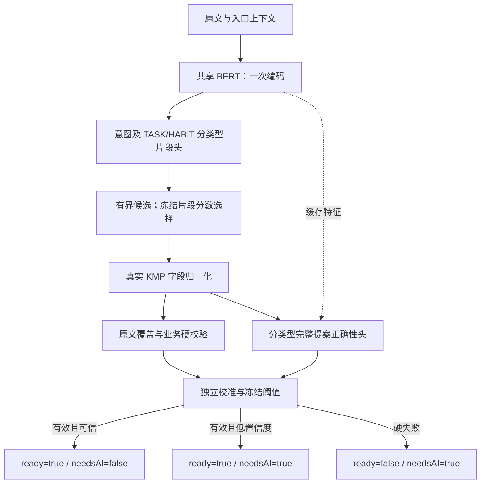

# TASK/HABIT 联合原型实施记录 v3

日期：2026-10-19。核心离线原型、主试验、ONNX及三随机种子复核完成；泛化和完整研究矩阵未完成。

本轮选中 **共享 BERT、分类型片段头、片段分数组合、分类型正确性评分及校准**。学习式重排在开发集降低覆盖，因此当前候选去掉了这层。最终合成留出分别达到 97.56% / 92.44%，但额外旧表达回放仅 **244/384（63.54%）**；整体 70% 泛化目标尚未证明，当前不能进入产品验收。

| 冻结业务测试 | 正例 | 完整正确且隐藏 AI | 正确覆盖 | 错误接受 | 单侧风险上界 |
| --- | ---: | ---: | ---: | ---: | ---: |
| TASK | 1,600 | 1,561 | 97.56% | 0 | 0.236% |
| HABIT | 1,600 | 1,479 | 92.44% | 0 | 0.249% |

最终两个上界各用 `alpha=0.025`，按预定规则合计保守 95%；仅适用于本次合成抽样与独立性假设。另有 800 条业务确认样本及 2,000 条保护样本，均无高置信度误接受。业务测试还有 1 条完整 HABIT 草案保持 `ready=true, needsAI=true`。其余不完整/硬失败保留原文并显示 AI。

## 实施范围

按已确认的[联合设计 v2](task-habit-joint-design-v2.md)实现一次 BERT 编码、片段候选组合、分类型排序及完整提案正确性评分，再独立校准 TASK/HABIT 的隐藏 AI 阈值。共用编码器不意味着两个业务必须共用边界头；开发集负迁移触发了小型类型分支对照。

`ready` 只表示草案完整且硬校验通过；低置信度有效草案仍为 `ready=true, needsAI=true`。没有合格阈值时保持 AI 按钮可见。高置信度不能越过原文覆盖、字段归一化或业务可表示性检查。

本轮没有客户端接入或模型发布。旧 BIO 清单不能消费新增角色及评分头，Android/iOS 的提交条件也仍需在后续接入时调整。

实际候选架构见 [Mermaid 源文件](task-habit-joint-prototype-v3.mmd)。单个输入只运行一次 BERT，缓存的特征供片段提取及正确性评分使用；不新增检索向量或向量数据库。



## Core 修复

- HABIT 结构化归一化分别消费执行日、目标窗口、次数和提醒时刻。工作日执行、每周累计三次可以同时成立；不从名称重新抽取这些字段。
- 修复单字“十”的数字解析。
- 修复星期数字与紧邻钟点的边界，例如“本周三11:30”“下周六14:00”。该问题由开发集金标诊断发现，修复前证据保留。

所有日期和 Habit 字段计算均调用实际 KMP 测试执行器。Python 不另写一套日期/习惯业务解析。

## 数据与首轮失败

v2 首轮的三个共享随机种子以及专用模型、采样比例和 adapter 权重均保留。开发集对照发现 TASK 的联合模型落后专用模型；已知回归还拒绝了用户原句“明天下午4点要在逸夫楼开会”。这一轮不进入最终留出评估。

v3 冻结 44,000 条合成原文，分为提取训练、排序训练、正确性训练、开发、校准拟合、阈值筛选、业务测试和保护测试八个分区。各分区原文、完整标题和地点实体隔离；仍共享合成句式，不是表达家族盲测。训练集补入旧训练数据回放、短名称、常见地点及已曝光回归，保留 TASK/HABIT/CONFIRM 的 40/40/20 比例。

已知回归被用于开发及 v3 训练，因此只验证功能回归，不计为独立识别准确率。训练 16,000 条正例、开发 1,600 条正例、已知回归 11 条正例的金标字段路径检查全部通过；这检查标注与 Core 契约，不是模型预测成绩。

全部数据均未经过独立人工审核。`formalGatePassed=false`，任何合成结果都不能替代真实用户和真机门禁。

## 开发对照与选型

下表为同一冻结开发集、每类 800 正例的 seed42 结果；前两列为硬校验通过且全字段正确的草案。专用模型仍真实预测类型，没有用金标路由。

| 提取与候选选择 | TASK | HABIT |
| --- | ---: | ---: |
| 共享片段头，片段分数 | 684 / 800（85.50%） | 744 / 800（93.00%） |
| 分类型片段头，片段分数 | 744 / 800（93.00%） | 758 / 800（94.75%） |
| 共享片段头，学习式重排 | 694 / 800（86.75%） | 716 / 800（89.50%） |
| 分类型片段头，学习式重排 | 706 / 800（88.25%） | 717 / 800（89.63%） |
| TASK 专用模型，片段分数 | 757 / 800（94.63%） | 不适用 |
| HABIT 专用模型，片段分数 | 不适用 | 780 / 800（97.50%） |

分类型提取头显著缓解 TASK 负迁移，但 seed42 的 HABIT 仍比专用模型低 2.75 个百分点，超过设计中的 2 点触发线。因此这不是“联合训练自然增益”的证据。共享编码器的收益目前是复用与体积；后续仍需处理残余负迁移。

分类型候选池中能找到正确组合的上限为 TASK 757/800、HABIT 767/800；片段分数选择得到 744/758。学习式重排进一步损失了 38/41 条正确草案，故当前不采用。该消融后重新生成实际选择结果、训练正确性头，未复用其他选择策略的校准器。

选型只使用开发集及已知回归。`champion-selection.json` 在首次读取校准分区之前写入，主候选固定为 seed42；43/44 是复核，不用于看到最终结果后换权重。

## 校准与规则对照

独立阈值分区中，TASK 正确接受 1,537/1,600，HABIT 1,518/1,600，均零错误；12 档联合搜索的单侧风险上界分别为 0.356% / 0.360%（`alpha=0.05/12`），通过预设 0.5% 筛查。冻结 `T_task=0.999`、`T_habit=0.90` 后才打开最终测试与保护集。TASK 多档覆盖相同，按预设平局规则取较高阈值。

同一业务测试上的真实 Core 原文规则基线，TASK 完整正确覆盖为 19.50%、错误接受 1,618/1,930；HABIT 为 24.63%、710/1,104。这里要求标题、地点备注、截止时间或习惯全部字段精确一致，规则经常把未支持内容保留在标题但仍接受。因此不能把这组错误率解释成规则在任意输入分布上的通用表现，也不是现有线上 BERT 混合策略的成绩。

置信度不能替代硬校验。最终业务集中有 TASK 33 份、HABIT 86 份错误草案的分数仍高于各自阈值，119 份均由原文覆盖硬校验挡下。这表明正确性评分在新实体上仍会过度自信；单纯把“超过90%”当作隐藏条件有风险。

## 旧表达兼容性回放：未达到 70%

最终主评估与阈值冻结后，用已经曝光的 `data/zh-fidelity-compare-v1/test.jsonl` 额外检查表达迁移。只保留其中 384 条 TASK 正例；旧确认标签包含当时尚未支持的 HABIT，因此其余 96 条排除，不改写历史金标。工具入口为 `tools/replay_joint_tasks.py`。

同一冻结模型、解码器和阈值正确接受 244/384（63.54%），错误接受 0；140 条未形成可接受草案。这里是已曝光的旧集兼容性诊断，既不是新的独立测试，也不用于回头修改当前权重或阈值。

进一步候选诊断：当前预测类型与每角色4个/beam32预算下，仅 **263/384（68.49%）** 的输入在候选池中存在正确有效组合；即使现有池的排序全对，仍达不到70%。140条未接受中，121条池中缺正确组合、19条池中有正确组合但未选中。其中38条TASK被路由为HABIT。按全部384正例计算，标题字段正确率79.17%、备注81.25%、截止时间90.89%，说明主要问题在类型/片段召回与角色边界，不能仅通过调正确性头或降低阈值解决。

新合成集与旧表达之间存在明显差距：共享生成句式和有限实体池使主测试偏乐观。下一轮应扩充更丰富的标题、参与人和复合地点表达，按表达家族隔离，并引入独立人工样本；保持当前保真与硬校验。降低隐藏阈值不能解决片段缺失，也不能修复字段边界。

## 交互回归

固定 `now=2026-10-19T04:00:00Z`、时区 `Asia/Shanghai`：

| 输入 | 实际提案 | 状态 |
| --- | --- | --- |
| 明天下午 4 点要在逸夫楼开会 | 开会；2026-10-20 16:00；地点：逸夫楼 | ready=true，needsAI=false |
| 工作日每周跑步三次 | 跑步；工作日 mask=31；WEEKLY / 3；无提醒 | ready=true，needsAI=false |
| 工作日早上8点背单词，每天两次 | 背单词；mask=31；DAILY / 2；08:00 | ready=true，needsAI=false |
| 跑步（HABIT 入口） | 每天、每计划日1次、无提醒；c≈0.8938 | ready=true，needsAI=true |
| 每天读书30分钟 | 不可完整表示计量单位，保留原文 | ready=false，needsAI=true |

11 条已知正例均形成正确有效草案，其中 10 条隐藏 AI；3 条已知负例全部保持硬失败。以上样例已曝光并进入 v3 训练，仅作回归。真实 CLI 已验证原句和纯习惯名称；Core/分词器版本错配会拒绝推理。

## 验证与产物入口

- macOS native Core快速添加64项行为测试、Python62项测试通过，包含日/周目标与执行日独立、星期紧邻钟点、单字十、门控独立、错类型校准负例等。
- ONNX 数值核对100条，最大绝对输出误差0.000134；开发/已知回归/最终业务/保护合计8,014条完整提案无差异，最大置信度差约0.0000011。
- 当前导出3个ONNX图：共享编码与片段图、TASK正确性头、HABIT正确性头，总计14,068,727字节。空的rank权重表示沿用片段分数，没有额外重排网络。
- 并发训练期间的桌面CPU编码图计时：ONNX P50约5.03ms、P95约33.97ms，仅95个预热后样本，不含分词/候选/KMP/UI，也不能代表手机P95或端到端耗时。
- 已验证Core与分词器错配时拒绝推理。尚未实现新协议的Core ML/MindSpore及三端消费，未做真机/内存门禁，不复用旧BIO清单冒充兼容。

源代码：`src/quickadd_training/joint_*.py`。数据和指纹：`data/zh-joint-v3/provenance.json`。完整逐条证据保存在 Git 忽略的 `reports/zh-joint-v3/`；权重保存在 Git 忽略的 `artifacts/zh-joint-v3-*`。

交互入口：

```sh
PYTHONPATH=artifacts/zh-joint-v3-runtime/src HF_HUB_OFFLINE=1 ../DeadlinerCore/build/quickadd-env/bin/python \
  -m quickadd_training.joint_predict '明天下午 4 点要在逸夫楼开会' \
  --prototype reports/zh-joint-v3/type42-base/prototype.json --core artifacts/zh-joint-v3-runtime
# 纯习惯名称需显式入口上下文
PYTHONPATH=artifacts/zh-joint-v3-runtime/src HF_HUB_OFFLINE=1 ../DeadlinerCore/build/quickadd-env/bin/python \
  -m quickadd_training.joint_predict '跑步' --kind HABIT \
  --prototype reports/zh-joint-v3/type42-base/prototype.json --core artifacts/zh-joint-v3-runtime
```

核心指纹：

- 选中权重：`artifacts/zh-joint-v3-type-seed42/joint.pt`，3,320,105 参数；约 13.30 MB PyTorch 文件。另加两个小型正确性头，共用一个编码器。
- 实际 Core 执行器 SHA256：`f986a4dc7f3360f2e6fde66da551a9dc0d9f5c6ca32bc6f56ecfe367485613bb`。
- 训练集 SHA256：`d5adf507dc5b45f102bada2cfa62f25185e4c880164c971c50dd31e5c7e5dd9b`。
- 最终业务集 SHA256：`8f43a825f908909e986766484ab87ee15b81e8c539fd885dae7bfe974e1e4b6b`。
- 保护集 SHA256：`6fde282191fd75fd5c1b7b500c31bc4570ff3ce2b1cabc8b72dfa504643d1c7d`。

完整权重、评分头、分词器、配置与规则指纹见 `type42-base/prototype.json`；校准器、阈值网格、完整预测和字段诊断见同目录 `report.json` 与 `*-predictions.json`。所有历史失败及未选候选均保留。

`artifacts/zh-joint-v3-runtime` 保存49份Python源码及匹配的native适配器快照，避免后续开发覆盖本轮复现路径。依赖版本记录在 `snapshot.json`，上述命令已验证；若使用当前源码，则需其指纹与冻结协议完全相同。

检查点按开发角色F1（90%）和意图准确率（10%）选择，尚未直接按完整提案覆盖选择。确认样本的角色也参与片段诊断；分类型头在训练使用监督类型、推理按预测类型路由，CONFIRM样本的角色F1尤其不能用于横向判断业务优劣。本报告架构比较采用真实Core组装结果；后续仍应补更贴近完整提案目标的检查点对照。

## 三随机种子复核与未完成对照

下表在同一开发集、同一片段分数组合策略下统计硬校验后完整正确草案；每域800正例。未使用金标类型给专用模型分流。专用模型尚未训练对应的正确性头/校准，故这些是草案阶段信号，不能冒充相同风险约束下的最终接受差距。

| seed | 共享头 TASK/HABIT | 分类型头 TASK/HABIT | 专用 TASK/HABIT |
| --- | --- | --- | --- |
| 42 | 684/800 · 744/800 | 744/800 · 758/800 | 757/800 · 780/800 |
| 43 | 753/800 · 757/800 | 734/800 · 724/800 | 751/800 · 793/800 |
| 44 | 736/800 · 741/800 | 742/800 · 722/800 | 760/800 · 761/800 |

共享与分类型头的差异随种子变化，不能把seed42的改善解释为普遍架构收益。分类型主线三个种子的开发原始正确性分数0.5诊断如下；它不是校准后的90%隐藏阈值。只有seed42执行冻结校准与最终测试，43/44仅复核，未用于看到最终结果后换模型。

| seed | TASK正确接受/800 | HABIT正确接受/800 | 观察错误 | 已知回归有效正例/负例误通过 |
| --- | ---: | ---: | ---: | --- |
| 42 | 744 | 758 | 0 | 11/11 · 0/3 |
| 43 | 730 | 724 | 0 | 11/11 · 0/3 |
| 44 | 742 | 722 | 0 | 11/11 · 0/3 |

每域相同输入各曝光8轮；联合模型总更新约为单个专用模型的两倍，不能把额外预算当作共享的因果收益。12个提取模型均保留参数、训练行数、检查点、耗时与SHA；并发训练的墙钟耗时不可直接比较设备性能。同总步数控制、J1共享正确性/校准头对照未完成；当前只完成主试验，不声称完整研究矩阵通过。

后续优先补表达家族/独立人工数据与类型、片段召回，再复核负迁移和预算对照；当前线上客户端保持原协议。紧凑数值与指纹见[证据JSON](evidence/task-habit-joint-v3.json)。
